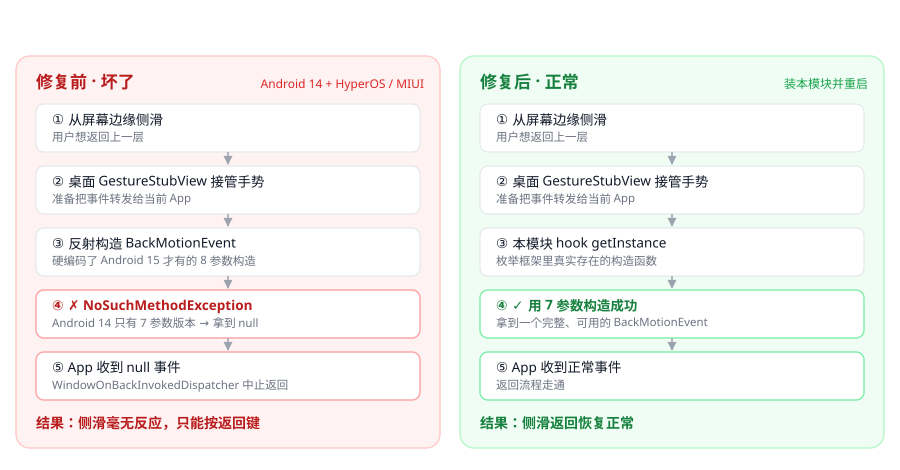

# MIUI Back Gesture Fix

**Swipe-to-go-back not working? This fixes it.**

<p align="right"><a href="README.md">简体中文</a> · <b>English</b></p>

An LSPosed module that repairs the **broken edge-swipe-back gesture** on **HyperOS / MIUI** — the one that makes Chrome, Mihon and many other apps ignore your swipe, while the back key still works fine.

[](https://github.com/a1175815821/MIUI-Back-Gesture-Fix/releases)
[](LICENSE)
[](#compatibility)
[](https://github.com/LSPosed/LSPosed)

> **Android 14 only.** Android 15+ does not have this bug — no need to install.

---

## 1️⃣ Do you need this? (30 seconds)

All three must be true:

- [ ] **HyperOS / MIUI** on **Android 14**
- [ ] Edge-swipe-back does **nothing**, but the **back key works**
- [ ] The broken apps are newer ones like **Chrome / Mihon**; swiping works in system Settings

If **every** app fails to swipe back, this is not your issue — check your navigation gesture settings first.

---

## 2️⃣ Install (3 steps, 1 minute)

| Step | What to do |
|---|---|
| **1** | Download `miuibackfix.apk` from [**Releases**](https://github.com/a1175815821/MIUI-Back-Gesture-Fix/releases/latest) and install it |
| **2** | Open **LSPosed** → Modules → enable **MIUI 侧滑返回修复** → make sure scope **`com.miui.home`** (system launcher) is checked |
| **3** | **Reboot** |

Swipe in any app afterwards — done 🎉

> Also available from the **official LSPosed repo** once listed: search "back gesture" in LSPosed's repository tab.

---

## 3️⃣ Still not working?

1. **Scope** — it must be **system launcher (`com.miui.home`)**, not the browser.
2. **Reboot** — the launcher process is long-lived and won't reload the module otherwise.
3. **Did the module actually load?** Check the LSPosed log (`/data/adb/lspd/log/`) for:
   ```
   (com.miui.home)[io.github.a1175815821.miuibackfix] [MiuiBackFix] built BackMotionEvent via 7-arg ctor
   (com.miui.home)[io.github.a1175815821.miuibackfix] [MiuiBackFix] getInstance -> fixed
   ```
   Missing → module not loaded. Present but still broken → different cause; please open an issue with your device + ROM version.

---

## Why only some apps break

The failing code path is only taken when an app registers a **predictive back animation callback** (`mIsAnimationCallback=true`):

| App | Predictive back | Swipe back |
|---|:---:|:---:|
| Chrome | ✅ | ❌ broken |
| Mihon | ✅ | ❌ broken |
| Settings | ❌ | ✅ fine |
| Via | ❌ | ✅ fine |

So it is **not** a browser problem — **every app supporting Android predictive back is affected**, and more apps add support with each release.

---

## FAQ

<details>
<summary><b>Any side effects? Battery drain?</b></summary>

The module touches a single method (`BackMotionEventProvider.getInstance`). The overhead per swipe is a few object constructions — negligible, nothing runs in the background.

On **Android 15+** the 8-arg constructor exists and the original code never fails, so the hook simply passes through.
</details>

<details>
<summary><b>Why not just switch launchers / Shizuku / accessibility service?</b></summary>

- **Switch launcher: no.** Both the stock launcher (5.39.31) and the updated build (5.39.35) contain identical code — it's a ROM-side bug.
- **Toggle "predictive back animation": no.** That setting only controls whether the animation plays; the forwarding code still runs and still fails.
- **Disable other Xposed modules: no.** Verified not a module conflict.
- **Shizuku / accessibility:** cannot reach a reflection call inside the launcher process.

Only hooking the failing call actually fixes it.
</details>

<details>
<summary><b>Upgrading from 1.0 to 1.1?</b></summary>

The package name changed (`com.wbai.miuibackfix` → `io.github.a1175815821.miuibackfix`), which means a different app:

**Uninstall the old one first**, install the new one, then re-enable it in LSPosed, re-check the scope, and reboot.
</details>

---

## Technical details



### Root cause

Before forwarding the gesture to the app, the launcher (`com.miui.home`) has to build an `android.window.BackMotionEvent`. Decompiling the launcher APK shows:

```
android.window.BackMotionEventProvider.getInstance:(FFFFFILjava/lang/Object;)Ljava/lang/Object;
```

It **hardcodes the Android 15-only 8-argument constructor**:

```
BackMotionEvent.<init>(float, float, float, float, float, boolean, int, RemoteAnimationTarget)
```

But **Android 14 only has the 7-argument version** (no `boolean isAnimationCallback`), so the call always fails:

```
ReflectUtils: java.lang.NoSuchMethodException: android.window.BackMotionEvent.<init> [...]
    at android.window.BackMotionEventProvider.getInstance(BackMotionEventProvider.java:30)
    at com.miui.home.recents.GestureStubView$OnBackInvokedCallbackImplU.onBackStart(GestureStubView.java:1522)
    at com.miui.home.recents.GestureStubView.onTouchEvent(GestureStubView.java:1026)
```

The failure yields `null`, yet MIUI still forwards it to the app:

```
WindowOnBackDispatcher: onBackStarted error, backEvent is null
```

The app then **aborts the back navigation** — hence the dead swipe.

### Fix

Inject into `com.miui.home` and hook the failing entry point, rebuilding the event with a constructor that actually exists:

```java
XposedBridge.hookAllMethods(
        XposedHelpers.findClass("android.window.BackMotionEventProvider", cl),
        "getInstance",
        new XC_MethodHook() {
            @Override
            protected void beforeHookedMethod(MethodHookParam param) {
                Object ev = buildBackMotionEvent(param.args, cl);
                if (ev != null) param.setResult(ev);
            }
        });
```

Key points:

- Constructors are **enumerated and matched by argument types** — no hardcoded signature.
- On Android 15+ the original path never fails, so the hook does not interfere.
- Fallback hook on `com.miui.launcher.utils.ReflectUtils.createNewInstance`.

---

## Compatibility

| Device | ROM | Android | Result |
|---|---|---|---|
| Redmi K50G (`22041216UC` / `xagapro`) | HyperOS 2.0 `OS2.0.12.0.ULOCNXM` | 14 | ✅ |

Reports for other HyperOS / MIUI builds are welcome — I'll add them to this table.

---

## Build from source

No Gradle needed — plain Android SDK build-tools:

```bash
bash build.sh
# output: build/miuibackfix.apk
```

Requires **JDK 17** + **Android SDK** (`build-tools` and `platforms/android-34`).
Adjust `SDK` and `JAVA_HOME_WIN` at the top of `build.sh` for your machine.

> ⚠️ Two gotchas:
> 1. `d8` / `aapt2` / `apksigner` are Windows binaries — pass **`C:/` style paths**;
> 2. The build directory **must not contain spaces** (the `$(find ...)` expansion breaks).

`lib/api82.jar` is the Xposed API used for compilation (`de.robv.android.xposed:api:82`).

### Signing

The build uses a **persistent key** at `keystore/miuibackfix.jks` (generated on first build; password is `KS_PASS` in the script).

- It is **not** committed (see `.gitignore`) — it is the release signing key; leaking it lets others forge an "update" for this package.
- **Back it up.** If lost, future versions can't upgrade over the old ones — users would have to uninstall first.
- Forking? Use your own key, but you cannot ship updates to this project's users with it.

---

## Project info

| Field | Value |
|---|---|
| Package | `io.github.a1175815821.miuibackfix` |
| Latest | `1.1` (versionCode `2`) |
| Scope | `com.miui.home` (system launcher) |
| Target | HyperOS / MIUI on Android 14 |
| LSPosed repo | [Xposed-Modules-Repo/io.github.a1175815821.miuibackfix](https://github.com/Xposed-Modules-Repo/io.github.a1175815821.miuibackfix) |

---

## Disclaimer

For learning and research purposes only. Modifying system behaviour carries risk — evaluate it yourself and **keep a backup**.

## License

[MIT](LICENSE)

---

<div align="center">

**If this fixed your phone, a ⭐ helps the next person find it.**

</div>
